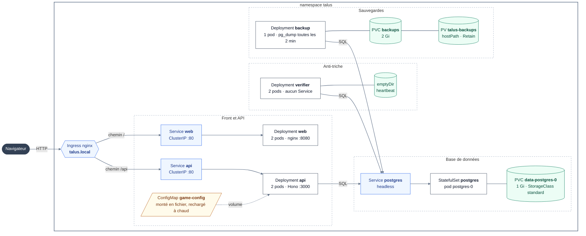

# Talus

TP Kubernetes (INFO910), Université Savoie Mont Blanc.

**Membre (travail individuel) : Antoine GUICHARD**

Talus est un jeu de conduite 2D pour navigateur : un petit véhicule roule sur un terrain infini, de plus en plus accidenté, en ramassant des pièces et des bidons d'essence. Un backend gère les comptes, le classement et une boutique d'améliorations.

Côté Kubernetes, l'originalité tient en quatre points :
- un **worker indépendant rejoue chaque partie** pour valider les scores (anti-triche), et se met à l'échelle séparément de l'API ;
- la **configuration du jeu** (physique, difficulté, prix, biomes) vit dans une ConfigMap et se modifie **à chaud**, sans reconstruire d'image ni redémarrer de pod ;
- chaque **sonde de santé** répond à une question précise, pour qu'une panne de base retire l'API du trafic sans la faire redémarrer en boucle ;
- la base est **sauvegardée en continu** sur un volume persistant qui survit à la suppression de la base, et **quatre scripts rejouent des pannes** de façon reproductible.

## Sommaire

1. [Le jeu](#1-le-jeu)
2. [Architecture](#2-architecture)
3. [Images Docker](#3-images-docker)
4. [Déployer sur Kubernetes (minikube)](#4-déployer-sur-kubernetes-minikube)
5. [Choix Kubernetes](#5-choix-kubernetes)
6. [Modifier la configuration du jeu à chaud](#6-modifier-la-configuration-du-jeu-à-chaud)
7. [Démonstrations reproductibles](#7-démonstrations-reproductibles)
8. [Commandes utiles pour observer le cluster](#8-commandes-utiles-pour-observer-le-cluster)
9. [Développement local (sans Kubernetes)](#9-développement-local-sans-kubernetes)
10. [Conclusion](#10-conclusion)

---

## 1. Le jeu

| Touche | Action |
|---|---|
| `→` ou `D` | Accélérer (en l'air : pencher en arrière) |
| `←` ou `A` | Freiner, puis reculer (en l'air : pencher en avant) |
| `R`, `Espace` ou `Entrée` | Relancer instantanément |
| `Échap` ou `P` | Menu pause (reprendre, recommencer, Garage, classement, compte) ; ferme aussi les fenêtres |

**Prise en main**
- L'écran titre présente les commandes avec de grosses touches illustrées. Appuyer sur `→` lance directement la partie.
- Pendant la partie, deux touches `←` `→` restent affichées en bas de l'écran : elles s'allument quand on appuie, et leur libellé change en l'air (*Tilt forward* / *Tilt back*).
- Des bulles de conseil apparaissent au bon moment : au départ, quand la voiture se cabre trop (seulement pendant les premières parties), et quand l'essence passe sous 25 %.

**Règles**
- La partie s'arrête si la tête du pilote touche le sol, ou si le véhicule n'a plus d'essence. Le score est la distance parcourue, en mètres.
- On peut jouer tout de suite, sans compte (mode invité). Avec un compte (tuile **Sign in** du menu), chaque partie est vérifiée par le serveur : la distance entre alors au **Leaderboard** et les pièces ramassées sont créditées.
- Le **Garage** permet d'acheter 4 améliorations avec ces pièces : moteur, pneus, suspension et réservoir. Chacune a 5 niveaux, et prend effet à la partie suivante.
- La difficulté monte vite au début, puis plus lentement : les collines s'élargissent et les pentes se raidissent jusqu'à environ 1 500 m. Le terrain reste toujours franchissable, car la pente est plafonnée.
- Le terrain traverse 5 biomes, chacun avec son ciel, ses montagnes, sa végétation, sa météo et son adhérence :
  - **Meadow** : arbres, fleurs, pollen.
  - **Desert** : mesas, cactus, vent de sable.
  - **Tundra** : sapins enneigés, aurore boréale, neige, sol glissant.
  - **Volcano** : volcan fumant, roches de lave, braises.
  - **Dusk** : lune, étoiles, cristaux et champignons lumineux, lucioles. Les phares s'allument dans les biomes sombres.

  Tout l'habillage d'un biome (couleurs, objets, densité, météo) est décrit dans la ConfigMap `game-config`.
- Dans les menus, une pastille `online · api-xxxx` indique le pod de l'API qui a répondu à la dernière requête. En rechargeant la page, on voit la répartition de charge du Service. À la fin d'une partie, la carte de résultat affiche le nom du pod verifier qui l'a validée.

### Pourquoi une physique « maison »

La physique (ressorts, roues, contact avec le sol) est écrite à la main dans `packages/game-core` et elle est **déterministe** :
- elle avance par pas de temps fixe de 1/120 s ;
- elle n'utilise que les opérations `+ − × ÷ √`, dont le résultat est identique au bit près dans tous les moteurs JavaScript (norme IEEE 754). Les fonctions comme `sin` ou `cos` n'ont pas cette garantie : la rotation du véhicule est donc stockée comme un vecteur unitaire plutôt que comme un angle ;
- le hasard vient d'un générateur pseudo-aléatoire initialisé par une graine.

Une partie se résume donc à **une graine et une liste de changements de touches** (quelques centaines d'octets), et le serveur peut la rejouer exactement : c'est la base de l'anti-triche. Les effets purement visuels (particules, chute du pilote, tremblement de caméra) sont calculés à part, dans le rendu, et n'influencent jamais le résultat.

## 2. Architecture



**Légende** : en bleu, l'exposition réseau (Ingress, Services) ; en blanc, les charges de travail (Deployments, StatefulSet) ; en vert, le stockage (volumes, PVC, PV) ; en jaune, la configuration. Flèches pleines : trafic réseau. Traits sans flèche : volumes attachés. Pointillés : configuration montée dans les pods.

Pour garder le schéma lisible, il ne montre que la ConfigMap du jeu. Le tableau ci-dessous donne la configuration reçue par chaque composant :

| Injecté dans les pods | web | api | verifier | backup | postgres |
|---|:-:|:-:|:-:|:-:|:-:|
| ConfigMap `game-config` (fichier `/etc/talus/game.json`) | | ✓ | | | |
| ConfigMap `platform` (variables d'environnement) | | ✓ | ✓ | ✓ | ✓ |
| ConfigMap `backup-script` (fichier exécutable) | | | | ✓ | |
| Secret `db-credentials` (variables d'environnement) | | ✓ | ✓ | ✓ | ✓ |
| Secret `api-session` (variable d'environnement) | | ✓ | | | |
| Downward API `POD_NAME` | | ✓ | ✓ | | |

Le verifier ne monte pas `game-config` : il relit dans la base la configuration enregistrée par l'API au début de chaque partie, retrouvée par son hash. Le pod `web` ne reçoit aucune configuration : le navigateur obtient celle du jeu en appelant `/api/config`.

### Les conteneurs

| Composant | Image | Port | Répliques | Rôle |
|---|---|---|---|---|
| `web` | `talus/web:1.0.0` (nginx non root) | 8080 | 2 | Sert le jeu (fichiers statiques React), avec un repli vers `index.html` |
| `api` | `talus/api:1.0.0` (Node 24) | 3000 | 2 | Comptes, parties, classement, boutique, configuration, sondes de santé |
| `verifier` | `talus/verifier:1.0.0` (Node 24) | aucun | 2 | Rejoue les parties en attente et les valide ou les rejette. Ne reçoit aucun trafic |
| `postgres` | `postgres:17-alpine` | 5432 | 1 | Base de données (comptes, parties, configurations) |
| `backup` | `postgres:17-alpine` | aucun | 1 | `pg_dump` toutes les 2 min, garde les 10 derniers dumps |

L'API et le verifier sont deux programmes distincts, avec deux images distinctes. Ils partagent seulement le code de simulation (`game-core`) et la base. On peut ainsi ajouter des verifiers quand la file d'attente grossit, sans toucher à l'API (voir la démo 3).

### Organisation du dépôt

| Dossier | Contenu |
|---|---|
| `packages/game-core` | Terrain, physique, simulation, rejeu, schéma Zod de la configuration. Utilisé **à la fois** par le navigateur et par le verifier |
| `packages/db` | Schéma Drizzle, migrations SQL, connexion PostgreSQL |
| `apps/web` | React, Zustand, rendu Canvas 2D (Vite, servi par nginx) |
| `apps/api` | API Hono |
| `apps/verifier` | Worker anti-triche |
| `k8s/` | Manifestes Kubernetes, numérotés dans l'ordre d'application et commentés |
| `scripts/` | Construction des images, déploiement, démonstrations, restauration, bot de test |

### Cycle de vie d'une partie connectée (anti-triche)

1. `POST /api/runs` : le **serveur** tire la graine du terrain. Il fige aussi un instantané de la configuration en vigueur (son hash) et des améliorations du joueur. Le client ne peut donc ni choisir un terrain facile, ni s'attribuer des améliorations qu'il n'a pas.
2. Le client joue et enregistre uniquement ses **changements de touches**, sous la forme `[tick, touches]`.
3. `POST /api/runs/:id/finish` : le client envoie ces changements, la distance et le nombre de pièces qu'il annonce. La partie passe en `pending`.
4. Un pod verifier prend une partie en attente avec `SELECT … FOR UPDATE SKIP LOCKED`. Plusieurs verifiers peuvent ainsi travailler en parallèle sans jamais traiter deux fois la même partie, et sans se bloquer entre eux.
5. Il rejoue la partie avec **exactement** la même graine, la même configuration (retrouvée en base par son hash) et les mêmes améliorations. Il exige ensuite la même distance au mètre près et le même nombre de pièces.
6. La partie est marquée `verified` (distance au classement, pièces créditées) ou `rejected` (avec la raison, par exemple `claimed 1014 m / 515 coins, replay gave 338 m / 15 coins`). Le verifier enregistre aussi son nom de pod dans `verified_by` et la durée du rejeu.

Tant qu'une partie n'est pas vérifiée, rien n'est crédité. Un client modifié peut envoyer n'importe quoi : seul le rejeu fait foi.

### Données

| Table | Contenu |
|---|---|
| `users` | Pseudo, mot de passe haché (scrypt), pièces, niveau de chaque amélioration |
| `game_configs` | Chaque configuration de jeu rencontrée, indexée par son hash (pour pouvoir rejouer une ancienne partie avec ses anciens réglages) |
| `runs` | Graine, hash de configuration, améliorations figées, touches, résultat annoncé, résultat vérifié, statut, pod verifier, durée du rejeu |

Le schéma est créé par les migrations Drizzle (`packages/db/drizzle/`), appliquées par l'API au démarrage, sous un verrou Postgres pour qu'une seule réplique les exécute.

### Routes de l'API

| Route | Rôle |
|---|---|
| `GET /api/config` | Configuration du jeu en vigueur, avec son hash |
| `POST /api/auth/register`, `/login`, `/logout` | Comptes. La session est un cookie `HttpOnly` signé (JWT) |
| `GET /api/me` | Profil : pièces, améliorations, meilleure distance |
| `POST /api/runs` | Réserve une partie (graine tirée par le serveur) |
| `POST /api/runs/:id/finish` | Envoie les touches et le résultat annoncé |
| `GET /api/runs/:id` | Statut de la vérification |
| `GET /api/runs/stats` | Nombre de parties par statut et par pod verifier |
| `GET /api/leaderboard` | 20 meilleures distances vérifiées, une par joueur |
| `POST /api/shop/buy` | Achat d'un niveau d'amélioration (mise à jour atomique : impossible de dépenser deux fois les mêmes pièces) |
| `GET /healthz/startup`, `/healthz/live`, `/healthz/ready` | Sondes Kubernetes (non exposées par l'Ingress) |

## 3. Images Docker

Les trois Dockerfiles (`apps/*/Dockerfile`) se construisent **depuis la racine du dépôt**, car les applications dépendent des paquets partagés `game-core` et `db`. Ils suivent tous le même principe :
- **Construction multi-étapes.** Une première étape `node:24-alpine` installe les dépendances avec pnpm et compile. L'image finale ne contient que le résultat : pas de sources TypeScript, pas d'outils de compilation, pas de `node_modules` complet.
- **API et verifier.** Le code est regroupé avec esbuild en un seul fichier `index.js`, lancé avec `node` sur `node:24-alpine`. Les migrations SQL sont copiées à côté.
- **Web.** Les fichiers statiques produits par Vite sont servis par `nginxinc/nginx-unprivileged`, sur le port 8080.
- **Aucune image ne tourne en root** (`USER node`, ou l'image nginx non privilégiée).
- `.dockerignore` exclut `node_modules`, `dist` et `docs/`, pour que le contexte de construction reste petit.

**Pourquoi `minikube image load`**

Le runtime de minikube est containerd, donc `eval $(minikube docker-env)` ne fonctionne pas. `scripts/build-images.sh` construit les images avec le Docker local, puis les copie dans le nœud avec `minikube image load`. Les manifestes utilisent un tag fixe (`1.0.0`) et `imagePullPolicy: IfNotPresent` : aucun registre n'est nécessaire.

## 4. Déployer sur Kubernetes (minikube)

### Prérequis

- `docker`, `minikube` et `kubectl`.
- Node.js 24 et pnpm ne servent qu'au bot de démonstration et au développement local.

### Installation

```bash
minikube start --driver=docker --cpus=4 --memory=6g
scripts/build-images.sh   # construit talus/{api,verifier,web}:1.0.0 et les charge dans minikube
scripts/deploy.sh         # active l'addon ingress, applique k8s/, attend que tout soit prêt
echo "$(minikube ip) talus.local" | sudo tee -a /etc/hosts
```

Il ne reste qu'à ouvrir <http://talus.local>.

Ce que fait `scripts/deploy.sh` :
1. `minikube addons enable ingress` : installe le contrôleur d'Ingress nginx.
2. `kubectl apply -f k8s/00-namespace.yaml` : le namespace doit exister avant les objets qu'il contient.
3. `kubectl apply -f k8s/` : applique les manifestes dans l'ordre de leur numéro (Secrets, ConfigMaps, base, API, verifier, web, sauvegardes, Ingress).
4. Attend que le StatefulSet puis chaque Deployment soient prêts (`kubectl rollout status`), puis affiche les pods, Services, Ingress et PVC.

Sans le script, les manifestes s'appliquent à la main :

```bash
minikube addons enable ingress
kubectl apply -f k8s/00-namespace.yaml && kubectl apply -f k8s/
```

### Vérifier que tout fonctionne

```bash
kubectl -n talus get pods
# attendu : 2 api, 2 web, 2 verifier, postgres-0 et 1 backup, tous Running et READY 1/1
kubectl -n talus get pvc
# attendu : data-postgres-0 et backups, Bound
curl -s -H "Host: talus.local" http://$(minikube ip)/api/config | head -c 120; echo
curl -s -D - -o /dev/null -H "Host: talus.local" http://$(minikube ip)/api/config | grep -i x-served-by
```

Au premier démarrage, il est normal que les pods `api` restent non prêts pendant une à deux minutes. Leur sonde de démarrage attend que Postgres ait fini son initialisation, puis applique les migrations.

Pour jouer une partie sans navigateur, et la voir vérifiée : `scripts/bot.sh --ip=$(minikube ip)`.

### Problèmes fréquents

| Symptôme | Cause probable et solution |
|---|---|
| Pods en `ErrImagePull` ou `ImagePullBackOff` | Les images n'ont pas été chargées dans minikube : relancer `scripts/build-images.sh` |
| Après une reconstruction, l'ancienne version tourne encore | Le tag ne change pas : `kubectl -n talus rollout restart deployment/api deployment/web deployment/verifier` |
| `talus.local` ne répond pas | Vérifier la ligne dans `/etc/hosts` (l'IP change si le cluster est recréé) et que le pod `ingress-nginx-controller` tourne : `kubectl -n ingress-nginx get pods` |
| L'Ingress répond `503` | Aucun pod api n'est prêt : la base démarre encore, ou elle est en panne (`kubectl -n talus get pods`) |
| Le jeu indique `offline · guest mode` | La page est ouverte par une autre adresse que `talus.local`, ou l'API ne répond pas. On peut quand même jouer, en invité |

Le déploiement a été testé sur Linux avec le driver docker, où l'IP de minikube est joignable directement. Sur macOS ou Windows avec le driver docker, ce n'est pas le cas : la documentation de minikube indique d'utiliser `minikube tunnel` et `127.0.0.1` à la place. Cette configuration n'a pas été testée ici.

### Tout supprimer

```bash
kubectl delete namespace talus && kubectl delete pv talus-backups
```

Le PV est en `Retain`, donc le contenu des sauvegardes reste dans `/data/talus-backups` sur le nœud minikube. Il disparaît avec `minikube delete`.

### Secrets

`k8s/10-secrets.demo.yaml` contient des **valeurs de démonstration**, clairement signalées (`demo-only-…`). Elles sont versionnées uniquement pour que le projet se déploie en une commande. En usage réel, on ne versionne pas ce fichier, et on crée les Secrets hors du dépôt :

```bash
kubectl -n talus create secret generic db-credentials --type=kubernetes.io/basic-auth \
  --from-literal=username=talus --from-literal=password="$(openssl rand -hex 24)"
kubectl -n talus create secret generic api-session \
  --from-literal=SESSION_SECRET="$(openssl rand -hex 32)"
```

## 5. Choix Kubernetes

Tous les objets utilisés sont des notions du cours. Chacun répond à un besoin précis de l'application.

| Notion du cours | Fichier | Objet | Pourquoi |
|---|---|---|---|
| **Namespace** | `00-namespace.yaml` | `talus` | Isole les noms, permet de tout supprimer en une commande, donne des noms DNS du type `*.talus.svc.cluster.local` |
| **Secret** | `10-secrets.demo.yaml` | `db-credentials` (type `basic-auth`), `api-session` (`Opaque`) | Mot de passe de la base et clé de signature des sessions, injectés par `secretKeyRef`. Ils ne sont jamais dans une ConfigMap ni dans une image |
| **ConfigMap (fichier)** | `20-configmap-game.yaml` | `game-config` monté en `/etc/talus/game.json` | Physique, carburant, difficulté, prix de la boutique et biomes, **modifiables à chaud** (section 6). Le fichier est validé par Zod : une configuration invalide est refusée et l'ancienne reste active |
| **ConfigMap (variables)** | `21-configmap-platform.yaml` | `platform` | Réglages non sensibles : hôte de la base, intervalle de rechargement de la configuration, rythme des sauvegardes |
| **StatefulSet + Service headless** | `30-postgres.yaml` | `postgres` | Le pod garde le nom stable `postgres-0` et le DNS stable `postgres-0.postgres`, utilisé par les applications. Son volume, créé par `volumeClaimTemplates`, lui reste attaché quand il est recréé. Un Deployment ne garantit ni l'un ni l'autre |
| **PersistentVolumeClaim (dynamique)** | `30-postgres.yaml` | `data-postgres-0` (1 Gi) | Les données de la base survivent à la suppression du pod (démo 1) |
| **Deployment** | `40-api.yaml`, `50-verifier.yaml`, `60-web.yaml` | `api`, `verifier`, `web` (2 répliques chacun) | Applications sans état : on peut supprimer, ajouter ou remplacer un pod à tout moment. Mises à jour progressives |
| **Service ClusterIP** | `40-api.yaml`, `60-web.yaml` | `api`, `web` | Adresse stable et répartition de charge entre les répliques. Le verifier n'a **pas** de Service, car il ne reçoit aucun trafic : il va lui-même chercher le travail en base |
| **Volume emptyDir** | `50-verifier.yaml` | `/run/heartbeat` | Le verifier y écrit un « battement de cœur », lu par sa sonde de vivacité |
| **PersistentVolume statique + PVC** | `70-backup.yaml` | PV `talus-backups` (2 Gi, `storageClassName: manual`, `Retain`), PVC `backups` lié par `selector` | Les sauvegardes sont sur un volume **distinct** de celui de la base. Elles survivent à la suppression de la base, de son PVC, et même du namespace (démo 4) |
| **ConfigMap (fichier exécutable)** | `70-backup.yaml` | `backup-script` (`defaultMode: 0755`) | Le script de sauvegarde vit dans le cluster : l'image officielle `postgres` suffit, pas besoin d'image personnalisée |
| **Deployment (stratégie Recreate)** | `70-backup.yaml` | `backup` | Une boucle `pg_dump` toutes les 2 min. `Recreate`, car le volume est en `ReadWriteOnce` : l'ancien pod doit libérer le volume avant que le nouveau démarre |
| **Ingress** (répartition par chemin) | `80-ingress.yaml` | `talus.local` : `/api` vers `api`, `/` vers `web` | Une seule origine pour le jeu et l'API, donc pas de CORS, et le cookie de session fonctionne directement |
| **Sondes** startup, liveness, readiness (http, tcp, exec) | tous | voir le tableau ci-dessous | Une question précise par sonde |
| **requests / limits** | tous | voir le tableau ci-dessous | Ressources garanties et plafonds |
| **Downward API** (variables d'environnement) | `40-api.yaml`, `50-verifier.yaml` | `POD_NAME` | Le nom du pod est renvoyé dans l'en-tête `X-Served-By` (affiché dans le jeu), et enregistré dans la colonne `verified_by` des parties |

**Pourquoi les sauvegardes ne sont pas un CronJob.** Les CronJob ne figurent pas dans le cours. Un Deployment qui exécute une boucle `pg_dump` / `sleep` rend le même service avec les notions du cours. Sa sonde de vivacité vérifie que la dernière sauvegarde est récente : si les sauvegardes s'arrêtent en silence, Kubernetes redémarre le pod, et le compteur de redémarrages le montre.

### Ressources

| Conteneur | requests (CPU / mémoire) | limits (CPU / mémoire) | Raisonnement |
|---|---|---|---|
| `postgres` | 250m / 256Mi | 1 / 512Mi | Le plus gros consommateur de mémoire |
| `api` | 100m / 128Mi | 500m / 256Mi | Requêtes courtes, pas de calcul lourd |
| `verifier` | 100m / 128Mi | 1 / 256Mi | Le rejeu d'une partie consomme du CPU par pics : la limite haute évite de ralentir la file d'attente |
| `web` | 25m / 32Mi | 200m / 64Mi | nginx ne sert que des fichiers statiques |
| `backup` | 25m / 32Mi | 500m / 256Mi | Inactif la plupart du temps, `pg_dump` ponctuel |

Au total, les requests valent environ 0,7 CPU et 0,9 Gi de mémoire : le projet tient sur un minikube modeste.

### Sondes de santé : une question précise par sonde

| Composant | startup | liveness | readiness |
|---|---|---|---|
| **api** | `/healthz/startup` : migrations appliquées (sous verrou consultatif Postgres, sans risque avec plusieurs répliques) et configuration chargée. Jusqu'à 2 min, le temps que la base démarre | `/healthz/live` : la boucle d'événements répond. **Ne teste pas la base**, pour qu'une panne de base ne provoque pas une tempête de redémarrages | `/healthz/ready` : base joignable et pod pas en cours d'arrêt. En cas d'échec, le pod sort des endpoints du Service, puis revient seul |
| **verifier** | premier battement de cœur écrit | battement de cœur de moins de 30 s (exec) : détecte une boucle bloquée. Le battement continue même si la base est en panne | aucune, car il n'est derrière aucun Service |
| **postgres** | `pg_isready` (jusqu'à 60 s, pour `initdb`) | `tcpSocket` 5432, volontairement plus léger que la readiness | `pg_isready` |
| **web** | inutile (nginx démarre instantanément) | `tcpSocket` | `GET /` |
| **backup** | une première sauvegarde existe | la dernière sauvegarde a moins de 2 intervalles + 1 min | aucune, sans objet |

L'idée générale : **liveness** répond à « faut-il redémarrer ce conteneur ? ». Elle ne doit échouer que si le redémarrer arrangerait les choses, et redémarrer l'API ne répare pas une base en panne. **Readiness** répond à « peut-on lui envoyer du trafic ? ». **Startup** protège les démarrages lents (initialisation de la base, migrations), pour qu'ils ne soient pas pris pour des pannes.

**Arrêt propre.** À l'arrêt (`SIGTERM`), l'API passe d'abord en « non prête », attend 5 s que le Service la retire de ses endpoints, puis se ferme. Les mises à jour progressives (`kubectl rollout restart`) ne coupent donc pas de requêtes en cours.

## 6. Modifier la configuration du jeu à chaud

Toute la configuration du jeu est dans `k8s/20-configmap-game.yaml`, sous la clé `game.json` :

| Section | Exemples de réglages |
|---|---|
| `physics` | `gravity`, `engineTorque`, `grip`, `suspensionStiffness`, vitesse de rotation en l'air |
| `fuel` | capacité, consommation, espacement des bidons |
| `terrain` | hauteur et pente des collines, distance sur laquelle la difficulté monte |
| `coins` | fréquence et valeur des pièces |
| `upgrades` | prix de chaque niveau, gain par niveau |
| `biomes` | distance d'apparition, adhérence, couleurs, décor, météo |

Pour la modifier : éditer le fichier (par exemple `"gravity": 9.81` → `"gravity": 5`), puis l'appliquer :

```bash
kubectl apply -f k8s/20-configmap-game.yaml
```

Ce qui se passe ensuite :
1. Le kubelet met à jour le fichier monté dans chaque pod api, après un délai variable (de quelques secondes à environ une minute).
2. L'API relit le fichier toutes les 5 s (`CONFIG_RELOAD_MS`), le valide avec Zod et l'enregistre en base sous son hash. Une valeur invalide (par exemple une gravité négative) est refusée avec un message dans les logs, et l'ancienne configuration reste active.
3. Les **nouvelles** parties utilisent la nouvelle configuration. Celles déjà commencées sont rejouées par le verifier avec la configuration de leur début, retrouvée par son hash.

Aucune image n'est reconstruite et aucun pod n'est redémarré. Pour voir la valeur servie par chaque pod :

```bash
for p in $(kubectl -n talus get pods -l app=api -o name); do
  kubectl -n talus exec $p -- wget -qO- localhost:3000/api/config | grep -o '"gravity":[0-9.]*'
done
kubectl -n talus logs deploy/api | grep -i config
```

Les valeurs par défaut sont aussi définies dans le code (`packages/game-core/src/config.ts`). `scripts/gen-game-configmap.sh` régénère la ConfigMap à partir du code, et un test vérifie que les deux restent identiques.

## 7. Démonstrations reproductibles

Chaque script s'exécute sur le cluster déployé et affiche ce qu'il fait, étape par étape. Les démos 3 et 4 utilisent le bot, qui demande Node.js et un `pnpm install` préalable. Tous les scripts ont été exécutés pendant le développement. Les résultats ci-dessous sont résumés.

### Démo 1 : supprimer le pod de la base (`scripts/demo-db-resilience.sh`)

*Ce qu'elle montre : StatefulSet, PVC, et la différence entre readiness et liveness.*
- `kubectl delete pod postgres-0` : le pod est recréé sous le **même nom**, avec le **même PVC** (`data-postgres-0`). Les joueurs et le classement sont identiques après coup.
- Panne prolongée (le StatefulSet est ramené à 0 réplique pendant environ 40 s) : au bout d'environ 10 s, les deux pods api passent `ready=false` et quittent les endpoints, et l'Ingress répond 503. Au retour de la base, ils redeviennent prêts **d'eux-mêmes**.
- Compteur de redémarrages des pods api : `0 0 → 0 0`. La liveness n'a pas réagi à la panne de base, comme prévu.

### Démo 2 : changer la gravité à chaud (`scripts/demo-config.sh`)

*Ce qu'elle montre : ConfigMap montée en fichier, mise à jour sans redémarrage.*
- La gravité passe de 9.81 à 1.62 (gravité lunaire) par un `kubectl apply` de la ConfigMap. **Chaque** pod api sert la nouvelle valeur, après un délai qui varie d'un pod à l'autre. Les UID des pods ne changent pas : aucun redémarrage.
- Une configuration invalide (gravité négative) est refusée, avec un message dans les logs, et l'ancienne reste active.
- La configuration d'origine est rétablie à la fin.

### Démo 3 : anti-triche et mise à l'échelle (`scripts/demo-anticheat.sh`)

*Ce qu'elle montre : un worker sans Service, mis à l'échelle indépendamment, et le partage du travail entre répliques.*
- Le verifier passe à 3 répliques (`kubectl scale`), et 6 bots jouent en même temps. Deux d'entre eux annoncent 3 fois leur vraie distance et 500 pièces de trop.
- Résultat obtenu : 4 parties `VERIFIED` et 2 `REJECTED` (`claimed 1014 m / 515 coins, replay gave 338 m / 15 coins`), réparties entre plusieurs pods (`verified_by`). Les tricheurs n'apparaissent pas au classement.
- On peut aussi jouer une seule partie à la main : `scripts/bot.sh --ip=$(minikube ip) [--cheat]`.

### Démo 4 : sinistre et restauration (`scripts/demo-backup-restore.sh`)

*Ce qu'elle montre : PV statique en `Retain`, indépendant du cycle de vie de la base.*
- Un dump est pris, puis on supprime le **StatefulSet et le PVC** de la base : les données sont réellement perdues.
- Le manifeste est réappliqué : la nouvelle base est vide (0 table).
- `scripts/restore-backup.sh <dump>` restaure depuis le PV de sauvegarde. Le résultat est identique (`2 players, 2 runs, 25 coins`) et le classement est revenu.

Pour lister les sauvegardes disponibles : `kubectl -n talus exec deploy/backup -- ls -lt /backups`. Sans argument, `scripts/restore-backup.sh` restaure la plus récente.

## 8. Commandes utiles pour observer le cluster

```bash
kubectl -n talus get pods -o wide                  # où tourne chaque pod, état, redémarrages
kubectl -n talus get endpoints api                 # pods api qui reçoivent du trafic (readiness)
kubectl -n talus describe pod -l app=api           # événements, résultats des sondes
kubectl -n talus logs -f deploy/verifier           # parties vérifiées ou rejetées en direct
kubectl -n talus top pods                          # consommation réelle (addon metrics-server requis)
kubectl -n talus scale deployment/verifier --replicas=4
kubectl -n talus rollout restart deployment/api    # mise à jour progressive, sans coupure
curl -s -H "Host: talus.local" http://$(minikube ip)/api/runs/stats   # parties par statut et par pod verifier
```

## 9. Développement local (sans Kubernetes)

```bash
pnpm install
pnpm test                                  # tests game-core (déterminisme, terrain, ConfigMap)
docker run -d --name talus-pg -e POSTGRES_USER=talus -e POSTGRES_PASSWORD=talus -e POSTGRES_DB=talus -p 55432:5432 postgres:17-alpine
pnpm --filter @talus/api build && DATABASE_PORT=55432 SESSION_SECRET=local-dev-secret-0123456789 node apps/api/dist/index.js
pnpm --filter @talus/verifier build && DATABASE_PORT=55432 node apps/verifier/dist/index.js
pnpm --filter @talus/web dev               # http://localhost:5173 (proxy /api vers :3000)
```

## 10. Conclusion

Talus montre qu'une application classique (un front, une API, une base) devient plus intéressante à déployer dès qu'on lui donne des besoins réels d'infrastructure :
- **Séparer les rôles** : l'API répond aux joueurs, le verifier rejoue les parties. Ce sont deux Deployments indépendants, qu'on met à l'échelle séparément, et le verifier n'a même pas besoin de Service.
- **Configurer sans reconstruire** : toute la physique, la difficulté, l'économie et l'habillage du jeu tiennent dans une ConfigMap, rechargée à chaud et validée. Chaque configuration est conservée en base, pour que l'anti-triche reste juste quand on change les réglages en cours de route.
- **Faire dire quelque chose de précis aux sondes** : une panne de base retire l'API du trafic sans la redémarrer, une boucle de verifier bloquée est redémarrée, et des sauvegardes qui s'arrêtent se voient dans le compteur de redémarrages.
- **Ne pas perdre les données** : le StatefulSet garde son volume quand son pod est recréé, et les sauvegardes vivent sur un volume persistant séparé, conservé même si la base et son PVC disparaissent.

Les quatre démonstrations de la section 7 rejouent chacun de ces comportements en une commande, sur le cluster déployé.

**Pistes d'amélioration**
- Postgres tourne avec une seule réplique. Pendant son redémarrage, l'API est volontairement retirée du trafic, mais ce n'est pas de la haute disponibilité : il faudrait une réplication Postgres.
- Le volume des sauvegardes est un `hostPath`, adapté à un cluster d'un seul nœud comme minikube. Sur un cluster de plusieurs nœuds, il faudrait un volume réseau.
- Les parties réservées mais jamais terminées restent en statut `started`. Un nettoyage périodique serait utile.
